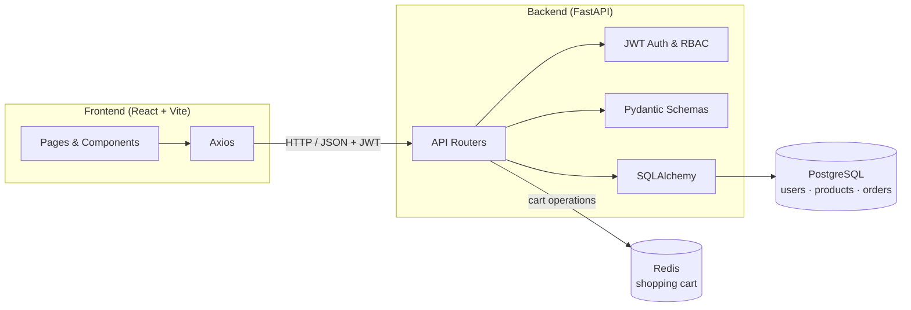
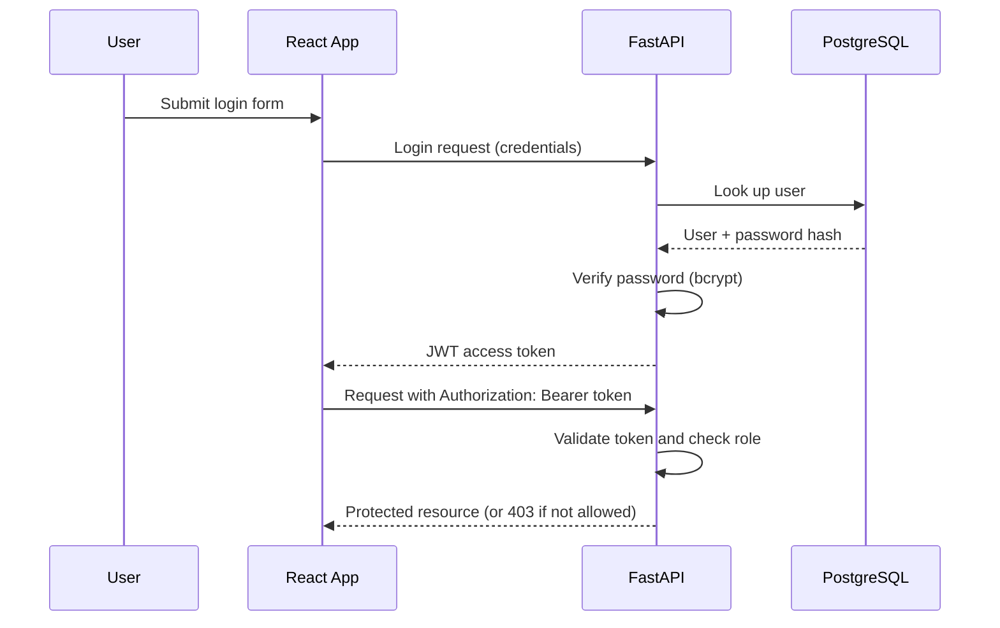

<div align="center">

# 🛒 PyShop

**A modern full-stack e-commerce platform built with FastAPI and React.**

JWT authentication · Role-based access · Redis-powered cart · PostgreSQL · One-command Docker setup


</div>

---

<!--
SCREENSHOTS (uncomment and add your images when ready):

## 📸 Screenshots

| Home / Catalog | Login | Cart |
|---|---|---|
|  |  |  |
-->

## 📋 Table of Contents

- [Overview](#-overview)
- [Features](#-features)
- [Tech Stack](#-tech-stack)
- [Architecture](#-architecture)
- [Authentication & Roles](#-authentication--roles)
- [Project Structure](#-project-structure)
- [Getting Started](#-getting-started)
- [Environment Variables](#-environment-variables)
- [API Documentation](#-api-documentation)
- [Troubleshooting](#-troubleshooting)
- [Contributing](#-contributing)
- [License](#-license)
- [Author](#-author)

---

## 📌 Overview

**PyShop** is a full-stack e-commerce web application with a microservices-inspired architecture. A FastAPI backend exposes a documented REST API, a responsive React frontend consumes it, PostgreSQL stores persistent data (users, products, orders) and Redis powers the shopping cart for fast, ephemeral state.

Everything runs in containers, so the whole stack starts with a single Docker Compose command and no local dependency setup.

---

## ✨ Features

### 🔐 Security
- Secure user registration and login with **JWT**.
- **Role-Based Access Control** separating Admin and Customer permissions.
- Passwords hashed with **Passlib + bcrypt**.

### 🛒 Shopping
- **Redis-backed shopping cart** for real-time state management and ephemeral storage.
- Orders, users and products stored safely in **PostgreSQL** through **SQLAlchemy**.

### 🧰 Administration
- Full **CRUD** operations for products (Admin only).

### 🏗 Developer Experience
- **One-command deployment** with Docker Compose.
- **Automatic API docs:** interactive Swagger UI and ReDoc generated by FastAPI.
- Request and response validation with **Pydantic** schemas.

---

## 💻 Tech Stack

### Frontend

| Technology | Purpose |
|---|---|
| [React](https://react.dev/) + [Vite](https://vitejs.dev/) | UI library and build tool |
| [Tailwind CSS](https://tailwindcss.com/) | Styling |
| [Axios](https://axios-http.com/) | HTTP client |

### Backend

| Technology | Purpose |
|---|---|
| [Python 3.10+](https://www.python.org/) | Language |
| [FastAPI](https://fastapi.tiangolo.com/) | Web framework |
| [SQLAlchemy](https://www.sqlalchemy.org/) | ORM |
| [Pydantic](https://docs.pydantic.dev/) | Data validation and schemas |
| [PyJWT](https://pyjwt.readthedocs.io/) | JWT creation and verification |
| [Passlib](https://passlib.readthedocs.io/) + [bcrypt](https://github.com/pyca/bcrypt) | Password hashing |

### Infrastructure

| Technology | Purpose |
|---|---|
| [PostgreSQL](https://www.postgresql.org/) | Primary relational database |
| [Redis](https://redis.io/) | In-memory store for the shopping cart |
| [Docker](https://www.docker.com/) + Docker Compose | Containerization and orchestration |

---

## 🏗 Architecture



---

## 🔑 Authentication & Roles



| Role | Permissions |
|---|---|
| **Customer** | Browse products, manage own cart, place orders |
| **Admin** | Everything a customer can do, plus full product management (create, update, delete) |

---

## 📁 Project Structure

```text
PyShop/
├── backend/                # FastAPI application
│   ├── app/                # Main application code
│   │   ├── api/            # API routers and endpoints
│   │   ├── core/           # Config, security, and DB setup
│   │   ├── models/         # SQLAlchemy models
│   │   ├── schemas/        # Pydantic schemas
│   │   └── main.py         # FastAPI entry point
│   ├── requirements.txt    # Python dependencies
│   └── Dockerfile          # Backend container configuration
├── frontend/               # React application (Vite)
│   ├── src/                # Components, pages, hooks, etc.
│   ├── package.json        # Node dependencies
│   └── Dockerfile          # Frontend container configuration
├── docker-compose.yml      # Orchestrates all services
└── README.md               # Project documentation
```

---

## 🚀 Getting Started

### Prerequisites

- [Docker Desktop](https://www.docker.com/products/docker-desktop/) installed and running
- [Git](https://git-scm.com/)

### 1. Clone the repository

```bash
git clone https://github.com/dereksxt/PyShop.git
cd PyShop
```

### 2. Configure environment variables

Create a `.env` file in the root directory (see [Environment Variables](#-environment-variables)).

### 3. Build and run with Docker

```bash
docker-compose up --build
```

### 4. Open the application

| Service | URL |
|---|---|
| Frontend (React) | http://localhost:5173 |
| Backend API | http://localhost:8000 |
| Swagger UI | http://localhost:8000/docs |
| ReDoc | http://localhost:8000/redoc |

### 5. Stop the application

Press `Ctrl+C`, or run:

```bash
docker-compose down
```

---

## 🔧 Environment Variables

| Variable | Description |
|---|---|
| `POSTGRES_USER` | PostgreSQL user |
| `POSTGRES_PASSWORD` | PostgreSQL password |
| `POSTGRES_DB` | Database name |
| `POSTGRES_HOST` | Database host (service name in Docker Compose) |
| `POSTGRES_PORT` | Database port |
| `REDIS_URL` | Redis connection URL |
| `SECRET_KEY` | Secret used to sign JWTs |
| `ALGORITHM` | JWT signing algorithm |
| `ACCESS_TOKEN_EXPIRE_MINUTES` | Token lifetime in minutes |

Example `.env`:

```env
# Database
POSTGRES_USER=postgres
POSTGRES_PASSWORD=yourpassword
POSTGRES_DB=pyshop_db
POSTGRES_HOST=db
POSTGRES_PORT=5432

# Redis
REDIS_URL=redis://redis:6379/0

# Security
SECRET_KEY=your_super_secret_jwt_key
ALGORITHM=HS256
ACCESS_TOKEN_EXPIRE_MINUTES=30
```

> ⚠️ These are placeholder values. Use your own credentials, never commit your real `.env`, and make sure it is listed in `.gitignore`.

---

## 📖 API Documentation

FastAPI generates interactive documentation automatically. With the app running:

- **Swagger UI:** [http://localhost:8000/docs](http://localhost:8000/docs)
- **ReDoc:** [http://localhost:8000/redoc](http://localhost:8000/redoc)

From Swagger you can register users, authenticate to obtain a JWT, and test the cart and product endpoints directly from your browser.

---

## 🩺 Troubleshooting

| Problem | Solution |
|---|---|
| Port `5432`, `6379`, `8000` or `5173` already in use | Stop the local service using that port or change the port mapping in `docker-compose.yml`. |
| Backend cannot connect to PostgreSQL | Make sure `POSTGRES_HOST=db` matches the service name in `docker-compose.yml` and that the other `POSTGRES_*` values are consistent. |
| Cart does not persist | Check that the Redis container is running and `REDIS_URL` points to it (`redis://redis:6379/0`). |
| `401 Unauthorized` | Log in again; the token may have expired (`ACCESS_TOKEN_EXPIRE_MINUTES`) or `SECRET_KEY` may have changed. |
| Changes in `.env` not applied | Rebuild the containers with `docker-compose up --build`. |

---

## 🤝 Contributing

Contributions, issues and feature requests are welcome! Feel free to check the [issues page](https://github.com/dereksxt/PyShop/issues).

1. Fork the project
2. Create your feature branch (`git checkout -b feature/AmazingFeature`)
3. Commit your changes (`git commit -m 'feat: add some AmazingFeature'`)
4. Push to the branch (`git push origin feature/AmazingFeature`)
5. Open a Pull Request

---

## 📄 License

This project is licensed under the MIT License — see the [LICENSE](LICENSE) file for details.

---

<div align="center">

**Built by [Derek Serpa](https://github.com/dereksxt)** 💻

</div>
